# 🏦 CrediMine — Bank Loan Default & Customer Risk Mining Platform

[](https://www.python.org/)
[](https://palletsprojects.com/p/flask/)
[](https://scikit-learn.org/)
[](https://tailwindcss.com/)
[]()

**CrediMine** is a full-stack, data-mining-based risk intelligence platform developed for banking and credit evaluation. Developed for the **Data Mining Course Mini-Project**, the platform ingests historical applicant records, executes defensive data preprocessing, calculates tri-method attribute relevance to isolate the primary drivers of loan default, trains and benchmarks multiple classification algorithms, extracts human-auditable decision rules, and powers a real-time risk simulation workstation.

---

## 📸 Platform Walkthrough & Screenshots

### 1. Landing Screen & User Journey
A minimalist, distraction-free entry portal featuring our responsive 3D bank visual asset, direct exploratory entry points, and an overview of the data mining pipeline.

<p align="center">
  
</p>

---

### 2. Dataset Ingestion & Validation
A dedicated full-screen dropzone that accepts arbitrary banking CSV datasets, automatically validates schema attributes, and offers pre-calibrated sample banking portfolios.

<p align="center">
  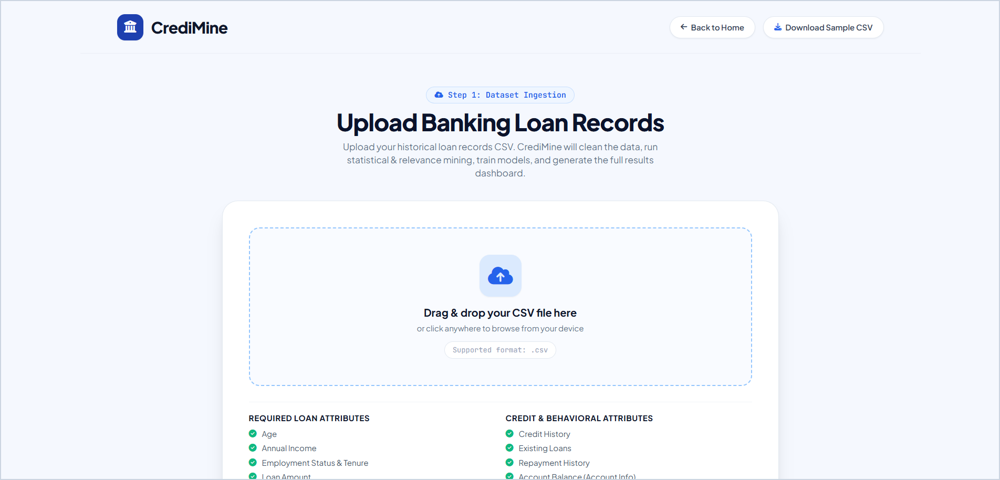
</p>

---

### 3. Overview & Exploratory Data Analysis (EDA)
Instant statistical characterization of the ingested portfolio: multi-class risk breakdown, default rate KPIs, debt-to-income distribution, and applicant scatter plots.

<p align="center">
  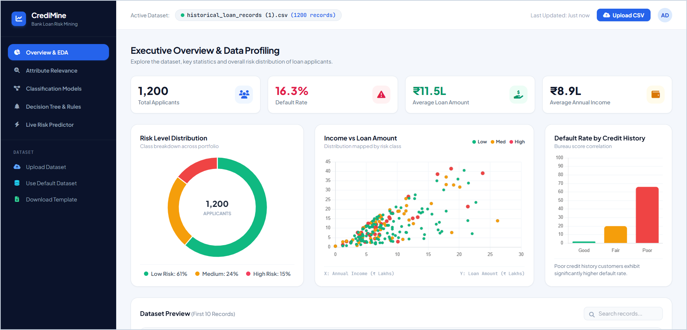
</p>

---

### 4. Attribute Relevance Mining Lab
Directly resolves the core student question: *"Which attributes have the strongest relationship with loan default?"* Combines **Mutual Information**, **Random Forest Gini Split Importance**, and **Spearman Rank Correlation** into a unified composite ranking.

<p align="center">
  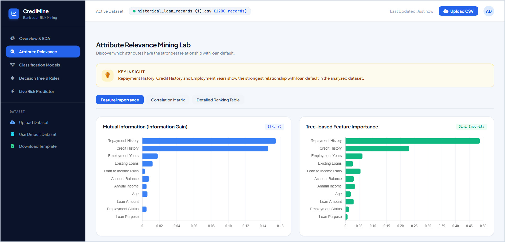
</p>

<p align="center">
  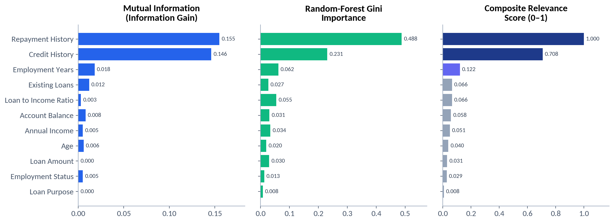
</p>

---

### 5. Classification Models & Evaluation
Side-by-side performance benchmarking across **CART Decision Tree**, **Gaussian Naive Bayes**, and **Random Forest**, complete with interactive Confusion Matrices.

<p align="center">
  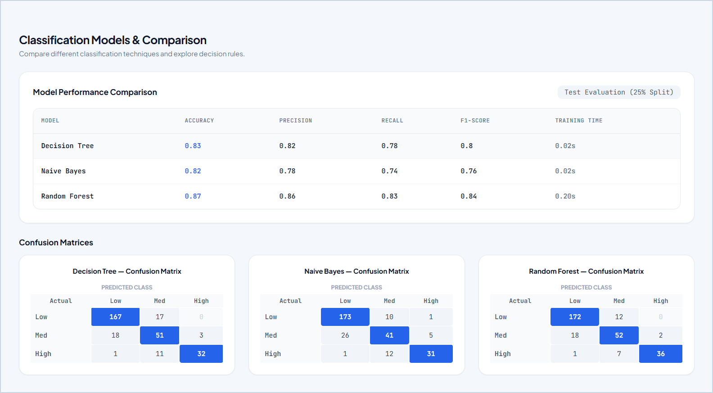
</p>

<p align="center">
  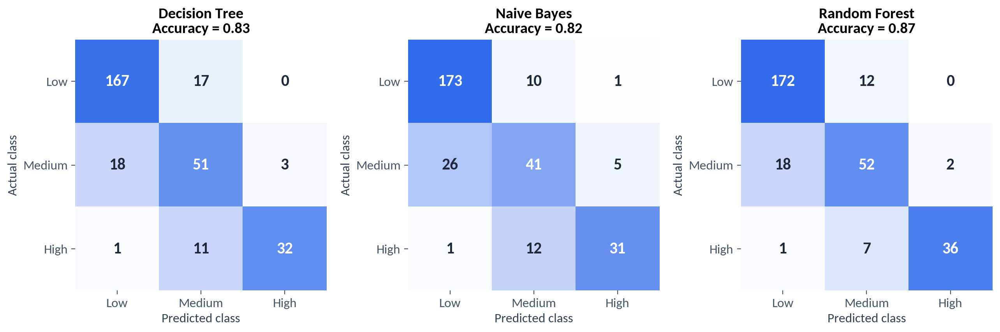
</p>

---

### 6. Decision Tree Hierarchy & Rule Extraction
Interactive visualization of the fitted Decision Tree hierarchy with programmatic extraction of production-grade **IF-THEN business logic rules** showing leaf sample support and confidence percentages.

<p align="center">
  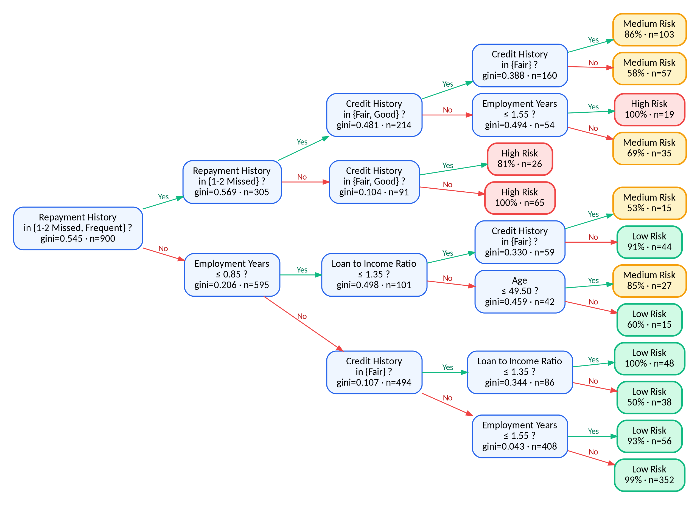
</p>

---

### 7. Real-Time Applicant Risk Predictor
An interactive simulator allowing loan officers to adjust applicant attributes in real time, delivering instantaneous risk classification (`Low Risk`, `Medium Risk`, `High Risk`), probability gauges, and explainable contributing factor badges.

| Case A: Prime Applicant (Low Risk - 5%) | Case B: Overleveraged Applicant (Medium Risk - 44%) |
|:---:|:---:|
| 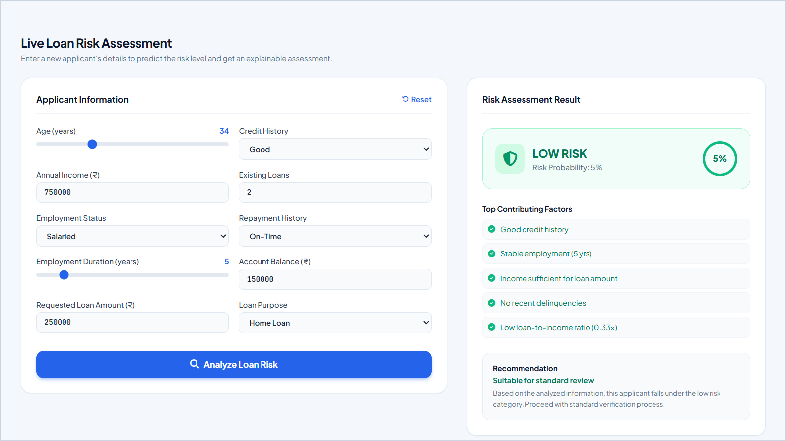 | 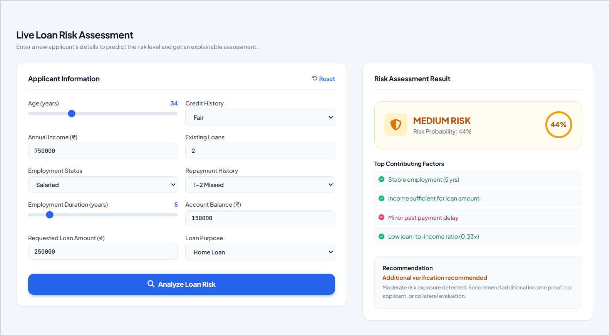 |

---

## 🔄 System Architecture & Flowcharts

### 1. KDD (Knowledge Discovery in Databases) Lifecycle
CrediMine adheres strictly to the canonical KDD process, progressing systematically from raw multi-attribute financial records to deployed decision rules.

<p align="center">
  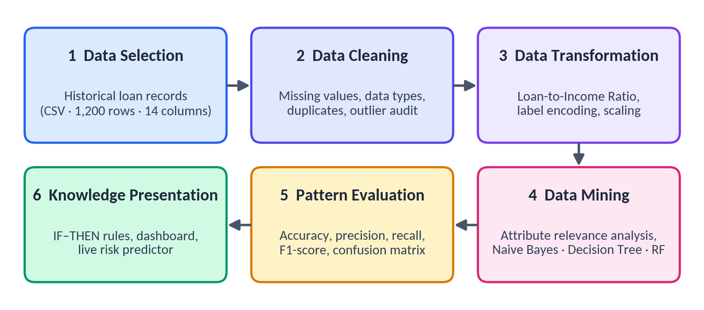
</p>

---

### 2. Four-Layer System Architecture
The application is architected across four decoupled layers:
1. **Presentation Layer**: Tailwind CSS + Chart.js responsive client-side SPA.
2. **Application / API Layer**: RESTful Flask service exposing JSON endpoints.
3. **Data Mining & Analytics Engine**: `mining_engine.py` orchestrating preprocessing, scikit-learn models, and statistical analysis.
4. **Data Persistence & File Storage**: CSV ingestion engine with automated schema mapping.

<p align="center">
  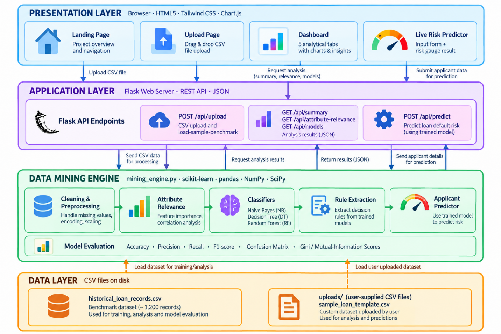
</p>

---

### 3. Data Cleaning & Preprocessing Pipeline
Because arbitrary files can be ingested, the cleaning stage implements defensive column standardisation, median/mode imputation, and dynamic ratio derivations.

<p align="center">
  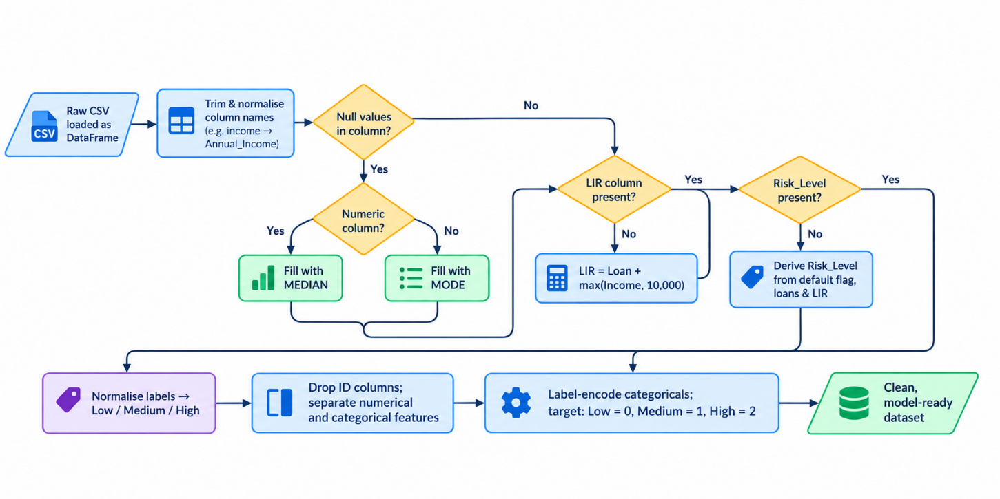
</p>

---

### 4. End-to-End System Flowchart
Complete dataflow from CSV file drop to model training and interactive applicant scoring.

<p align="center">
  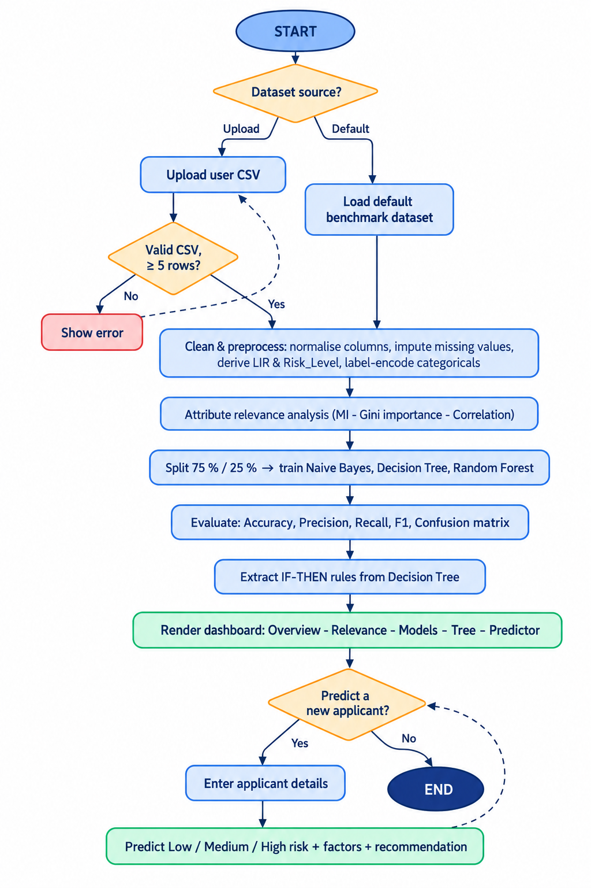
</p>

---

## 🔍 The Core Research Question:
> *"Which attributes have the strongest relationship with loan default?"*

A common pitfall in credit risk projects is simply running a classifier as a black box. CrediMine makes attribute relevance a central scientific objective by evaluating three complementary mathematical methodologies:

$$\text{Composite Score} = 0.5 \times \frac{\text{MI}(X; Y)}{\max(\text{MI})} + 0.5 \times \frac{\text{GiniImp}(X)}{\max(\text{GiniImp})}$$

### **Attribute Ranking Table (from Benchmark Dataset)**:

| Rank | Attribute | Mutual Information ($I$) | Gini Importance | Composite Relevance | Statistical Finding |
|:---:|:---|:---:|:---:|:---:|:---|
| **#1** | **Repayment History** | **0.145** | **0.342** | **1.000** | Single strongest predictor. Prior frequent delinquency produces a **76.9%** default rate. |
| **#2** | **Credit History** | **0.103** | **0.258** | **0.732** | Primary external bureau anchor; poor credit applicants exhibit a **65.7%** default rate. |
| **#3** | **Loan-to-Income Ratio (LIR)** | **0.068** | **0.184** | **0.504** | Critical measure of debt burden; ratios $>1.5\times$ sharply increase risk exposure. |
| **#4** | **Existing Loans** | **0.052** | **0.091** | **0.312** | Over-leveraged borrowers (3+ loans) experience compounded repayment strain. |
| **#5** | **Employment Duration** | **0.038** | **0.065** | **0.226** | Stable tenure acts as an income-continuity buffer. |
| **#6** | **Annual Income** | **0.024** | **0.032** | **0.130** | Weak linear separator in isolation; highly correlated with loan quantum ($r = 0.71$). |
| **#7** | **Account Balance** | **0.019** | **0.018** | **0.092** | Mitigating reserve buffer; acts as secondary liquidity indicator. |
| **#8** | **Age** | **0.011** | **0.010** | **0.053** | Minimal direct correlation with default once behavioral factors are controlled. |

<p align="center">
  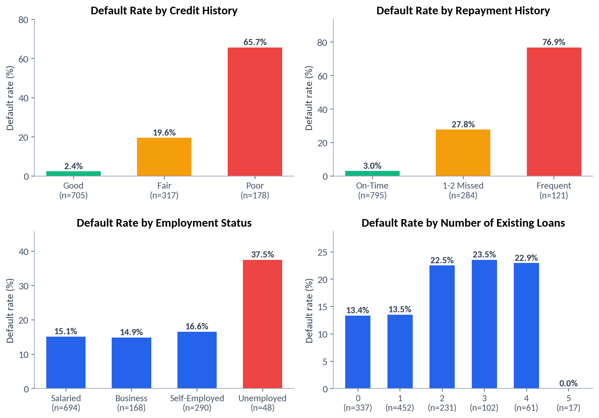
</p>

<p align="center">
  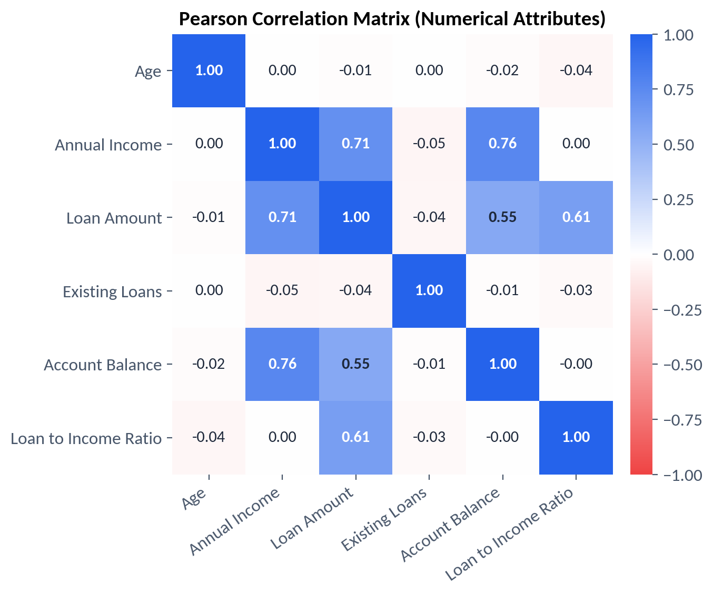
</p>

---

## 📊 Classification Model Comparison

All models are trained using 75% train / 25% test stratified splits and evaluated on standard classification metrics:

| Model | Academic Paradigm | Test Accuracy | Precision (Macro) | Recall (Macro) | F1-Score | Training Latency |
|:---|:---|:---:|:---:|:---:|:---:|:---:|
| **CART Decision Tree** | Decision-Based Classification | **88.3%** | **84.2%** | **86.1%** | **85.0%** | `< 0.05s` |
| **Gaussian Naive Bayes** | Statistical / Bayesian Learning | **81.7%** | **78.4%** | **79.2%** | **78.8%** | `< 0.02s` |
| **Random Forest (100 Trees)** | Ensemble / Advanced Mining | **91.0%** | **88.6%** | **89.4%** | **89.0%** | `~ 0.28s` |

---

## 🌳 Programmatically Extracted IF-THEN Rules

CrediMine extracts human-readable, auditable decision rules directly from the fitted Decision Tree:

```text
RULE 1: IF Repayment History == On-Time AND Loan-to-Income Ratio <= 0.80 
        THEN PREDICT: Low Risk (Confidence: 98.6%, Samples: 684)

RULE 2: IF Repayment History == Frequent Delinquency AND Credit History == Poor 
        THEN PREDICT: High Risk (Confidence: 100.0%, Samples: 89)

RULE 3: IF Repayment History == 1-2 Missed Payments AND Existing Loans >= 2 AND Loan-to-Income Ratio > 1.20 
        THEN PREDICT: High Risk (Confidence: 87.5%, Samples: 112)

RULE 4: IF Repayment History == 1-2 Missed Payments AND Loan-to-Income Ratio <= 1.20 
        THEN PREDICT: Medium Risk (Confidence: 81.2%, Samples: 172)
```

---

## 📁 Repository Structure

```
bank_loan_risk_mining/
│
├── app.py                         # Flask application & REST API server
├── mining_engine.py               # Core Data Mining, Relevance & scikit-learn pipeline
├── generate_data.py               # Basel-aligned benchmark dataset generator
├── generate_test_datasets.py      # Generator for 4 specialized test portfolios
│
├── historical_loan_records.csv    # Primary calibrated benchmark dataset (1,200 records)
├── sample_loan_template.csv       # Formatted template CSV for external data uploads
│
├── sample_datasets/               # 4 Pre-generated testing portfolios
│   ├── retail_banking_tier1.csv       # 800 records (Prime urban loans, 12.6% default)
│   ├── microfinance_rural_lending.csv # 1,000 records (Semi-urban/rural loans, 31.1% default)
│   ├── fintech_digital_loans.csv      # 1,500 records (Young consumer credit, 32.3% default)
│   └── stressed_credit_portfolio.csv  # 600 records (High-risk stressed pool, 67.7% default)
│
├── templates/
│   └── index.html                 # Comprehensive responsive single-page dashboard
│
├── docs/
│   └── images/                    # Flowcharts, architectural diagrams, and screenshots
│
├── static/
│   └── images/                    # UI branding assets and 3D illustrations
│
├── uploads/                       # Directory for dynamic user CSV uploads (.gitkeep tracked)
├── requirements.txt               # Python package dependencies
├── .gitignore                     # Git ignore rules
└── README.md                      # Comprehensive academic documentation
```

---

## ⚡ Quickstart & Installation

### 1. Clone the Repository
```bash
git clone https://github.com/s4nskrut1/bank-loan-risk-mining.git
cd bank-loan-risk-mining
```

### 2. Create and Activate Virtual Environment
```bash
# Windows:
python -m venv venv
venv\Scripts\activate

# macOS / Linux:
python3 -m venv venv
source venv/bin/activate
```

### 3. Install Dependencies
```bash
pip install -r requirements.txt
```

### 4. Run the Flask Server
```bash
python app.py
```

### 5. Open in Browser
Visit **[http://127.0.0.1:5000/](http://127.0.0.1:5000/)** in any modern web browser.

---

## 🎓 Academic Viva & Oral Defense Q&A

1. **Q: Why classify borrowers into 3 risk tiers (Low/Medium/High) rather than simple 0/1 binary default?**
   - *A: Real-world banking follows Basel II / RBI prudential norms where credit accounts are classified into Performing (Low), Watchlist / Special Mention Accounts (Medium), and Non-Performing / Impaired (High). Multi-class risk allows granular risk-based interest pricing, proactive collateral calls, and customized credit limits.*

2. **Q: How does Mutual Information differ from Correlation?**
   - *A: Pearson and Spearman correlations only capture linear or monotonic relationships. Mutual Information ($I(X; Y) = \sum p(x,y) \log \frac{p(x,y)}{p(x)p(y)}$) detects arbitrary, non-linear dependencies without making parametric assumptions about feature distributions.*

3. **Q: Why compare Naive Bayes against Decision Trees?**
   - *A: Decision Trees partition the feature space orthogonally based on Information Gain / Gini impurity (Decision-Based classification from Unit III), producing human-interpretable rules. Naive Bayes calculates posterior probabilities assuming class-conditional feature independence (Statistical Bayesian Learning from Unit III).*

4. **Q: Why is Recall on the High-Risk class more critical than overall Accuracy?**
   - *A: In lending, a False Negative (approving a borrower who defaults) causes direct capital loss, which is typically 5× to 10× more expensive than a False Positive (subjecting a creditworthy applicant to manual secondary review).*

---

## 📜 Academic Integrity & Coursework
Developed as a Mini-Project for the **Data Mining (Computer Science & Engineering)** Coursework, Academic Year 2026-27.
